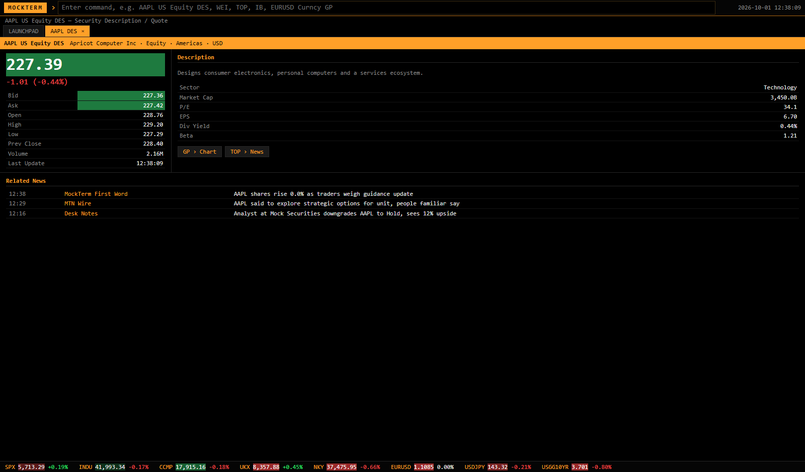
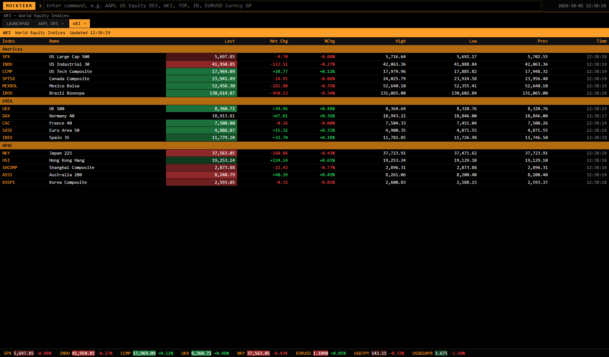
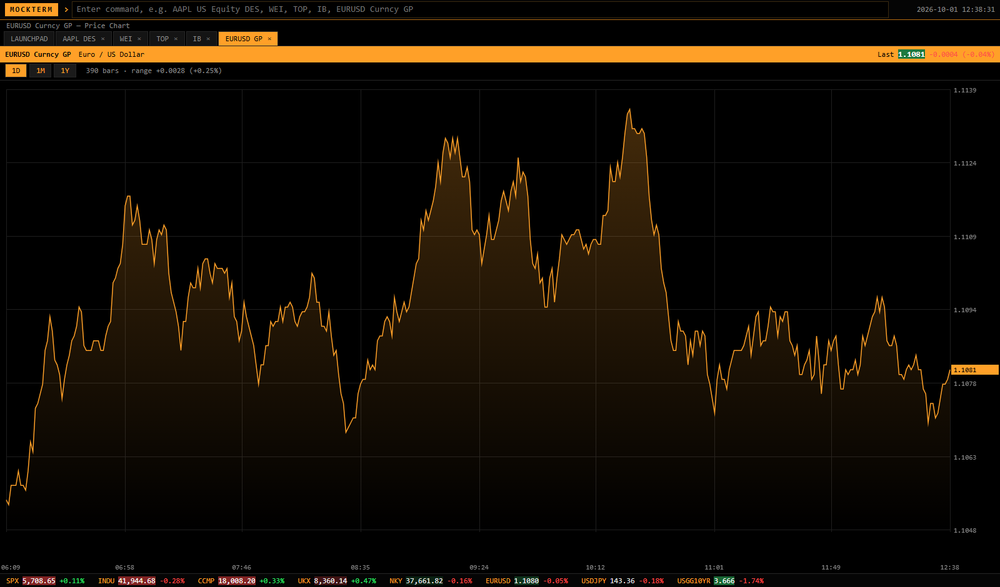
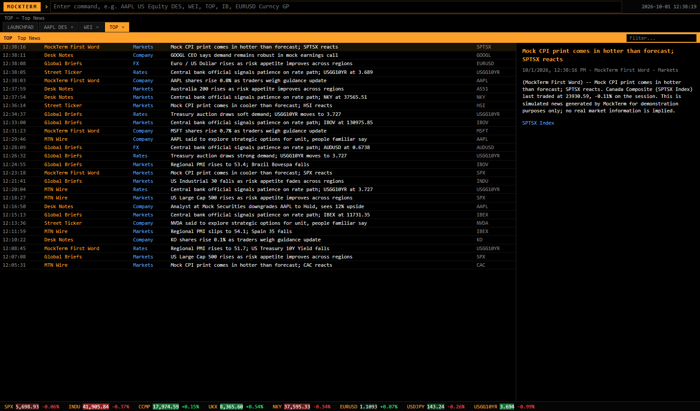
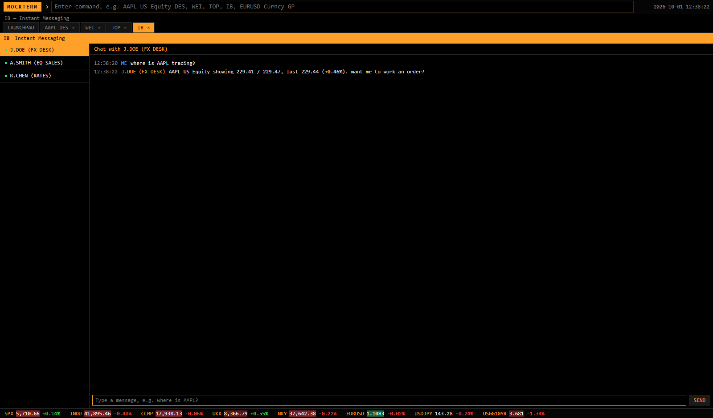

# MockTerm

A Windows desktop market terminal **mock**: a native C++ host that embeds
Chromium via the [Chromium Embedded Framework (CEF)](https://bitbucket.org/chromiumembedded/cef),
a native market-data simulator, and a set of dense, keyboard-driven TypeScript
"terminal apps" rendered inside it. All data is simulated; no real market data
or third-party branding is used.


| Item | Version |
| --- | --- |
| CEF | `154.0.25+g1bc6331+chromium-154.0.8037.44` (Standard Distribution, windows64) |
| Chromium | `154.0.8037.44` |
| Toolchain | MSVC 14.44 (Visual Studio 2022 Build Tools), CMake >= 3.21, Node >= 20 |

The CEF version is pinned in exactly one place: `CEF_VERSION` in
[`cmake/cef.cmake`](cmake/cef.cmake). See [docs/UPGRADING.md](docs/UPGRADING.md).

## Quick start

```powershell
# Prereqs: Visual Studio 2022 (or Build Tools) with "Desktop development with C++",
#          Node.js 20+, PowerShell 5+. CMake is taken from PATH or the VS install.
scripts\build.ps1                      # fetch CEF, build apps, CMake Release x64, ctest
scripts\run.ps1                        # launch build\host\Release\mockterm.exe
scripts\run.ps1 --remote-debugging-port=9222   # with DevTools / CDP enabled
```

`scripts\build.ps1` options: `-Clean` (wipe `build/`), `-Config Debug`, `-SkipTests`.
`scripts\get-cef.ps1` downloads and SHA1-verifies the pinned CEF distribution
into `third_party/cef/` (about 300 MB compressed); `build.ps1` calls it automatically.

The runtime is self-contained in `build\host\Release\`: `mockterm.exe`, the CEF
binaries/resources, and the bundled apps under `apps\`.

## Using the terminal

Type into the command line at the top and press **Enter** (`<GO>`):

| Command | Screen |
| --- | --- |
| `AAPL US Equity DES` | Security description, live quote, fundamentals, related news |
| `EURUSD Curncy GP` | Price chart (1D / 1M / 1Y) with live last price |
| `WEI` | World equity indices monitor, grouped by region, live ticks |
| `TOP` | Top news with live headlines and story view (`AAPL US Equity TOP` filters) |
| `IB` | Instant messaging with simulated counterparties |

Commands are case-insensitive; short tickers resolve (`aapl gp`), and a bare
security opens `DES`. Keys: **Tab** autocompletes, **Up/Down** recall history
(persisted), **F2** toggles tiled panels, **Ctrl+W** closes the active panel,
**Esc** clears. Double-click a WEI row to chart it; ticker links in TOP open DES.

## Repository layout

```
cmake/cef.cmake          CEF version pin + locator
host/main.cpp            wWinMain -> platform::RunMain
host/platform/           ALL direct CEF usage: process entry, CefApp/CefClient,
                         mockterm:// scheme handler, browser + renderer bridge
host/marketdata/         CEF-free simulator, subscriptions, news, chat, JSON
host/tests/              GoogleTest unit tests (ctest)
apps/src/                TypeScript apps: shell, des, gp, wei, top, ib, common
apps/src/types/mockterm.d.ts   the window.mockterm contract
apps/test/               Vitest tests (command parser, autocomplete, history)
scripts/                 get-cef.ps1, build.ps1, run.ps1, e2e.ts (Playwright over CDP)
docs/                    ARCHITECTURE.md, UPGRADING.md, screenshots
```

## Tests

```powershell
cd apps; npm test                                   # Vitest
ctest --test-dir build -C Release --output-on-failure   # GoogleTest (run by build.ps1)
cd scripts; npm ci; npm run e2e                     # launches mockterm.exe with
                                                    # --remote-debugging-port=9222
```

The end-to-end test attaches Playwright via CDP, opens every screen from the
command line, asserts live ticks change the DOM over several seconds, sends an
IB message and waits for the reply, and writes screenshots to
`artifacts/screenshots/`. Use `npm run e2e -- --attach` to drive an instance
that is already running.

## Screenshots

| | |
| --- | --- |
|  |  |
|  |  |
|  |  |

## Limitations

- CEF runs without the sandbox (`USE_SANDBOX OFF`, `no_sandbox = true`) to keep
  the build simple; see ARCHITECTURE.md.
- Windows x64 only.
- All prices, news and chat are synthetic and deterministic per seed.
